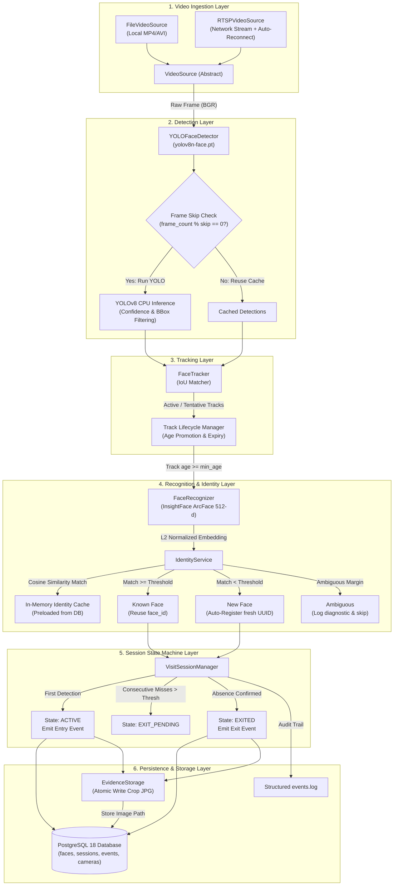
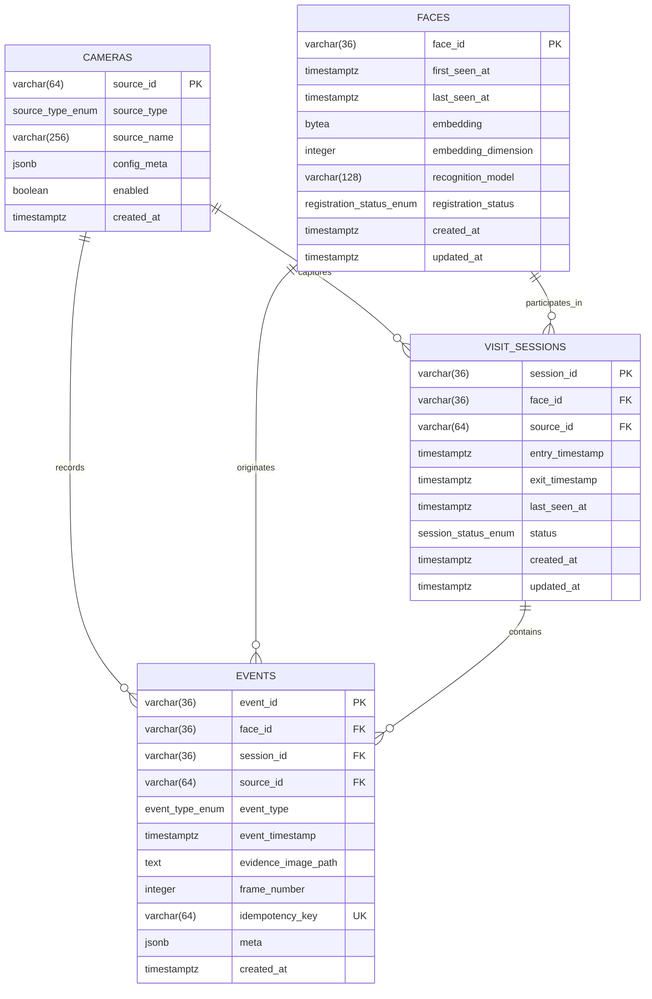

# SentinelTrack — System Architecture

## 1. System Overview

**SentinelTrack** is an AI-driven computer vision system that performs unique visitor tracking, automated face registration, re-identification, dwell-time measurement, and audit event persistence across video streams.

The architecture is strictly modularized into decoupled layers:
1. **Video Ingestion Layer**: Abstraction over local files, webcams, and RTSP network streams with bounded reconnects.
2. **Detection Layer**: YOLOv8 face detector (`yolov8n-face.pt`) running on configurable skip intervals.
3. **Tracking Layer**: IoU-based multi-object tracker maintaining temporal coherence and track lifecycles.
4. **Recognition & Embedding Layer**: InsightFace ArcFace model generating 512-dimensional L2-normalized feature vectors on CPU.
5. **Identity & De-duplication Layer**: Memory-cached identity registry comparing query embeddings via cosine similarity, preventing duplicate registration via cooldown guards and ambiguity margins.
6. **Session & State Machine Layer**: Deterministic state machine governing `NOT_PRESENT -> ACTIVE -> EXIT_PENDING -> EXITED` transitions.
7. **Persistence & Evidence Layer**: PostgreSQL database with normalized tables, transactional atomicity, idempotency keys, partial unique constraints, and collision-resistant cropped face storage.
8. **Logging & Observability Layer**: Rotating `events.log` writer and real-time hardware metrics collector.

---

## 2. Architecture & Pipeline Diagram



---

## 3. Data Flow Workflows

### 3.1 First-Time Visitor (Registration & Entry)
1. **Frame Capture**: Frame arrives from `VideoSource` (file or RTSP).
2. **Face Detection**: `YOLOFaceDetector` locates face coordinates `(x1, y1, x2, y2)` with confidence score $\ge 0.45$.
3. **Tracking Association**: `FaceTracker` associates detection with Track $T_1$ (state: `TENTATIVE`).
4. **Age Promotion**: When Track $T_1$ reaches `min_track_age_frames` (e.g. 3 consecutive frames), it is promoted to `ACTIVE`.
5. **Crop & Normalization**: `FaceRecognizer` extracts face bounding box with padding, computes 512-dimensional ArcFace vector $\mathbf{e}$, and normalizes $\hat{\mathbf{e}} = \frac{\mathbf{e}}{\|\mathbf{e}\|_2}$.
6. **Similarity Search**: `IdentityService` computes cosine similarity $S = \hat{\mathbf{e}} \cdot \hat{\mathbf{e}}_i$ against all registered identities in the in-memory cache.
7. **Identity Creation**: No candidate exceeds `similarity_threshold` (0.45). A new stable UUID `face_id` is assigned.
8. **Database Registration**: `FaceRepository.register_new` persists `face_id`, creation timestamp, and serialized embedding vector to the `faces` table. Cache is immediately updated.
9. **Visit Session Creation**: `VisitSessionManager.on_face_seen` creates a new row in `visit_sessions` with status `ACTIVE`.
10. **Evidence Storage**: `EvidenceStorage.save_evidence` writes the cropped face image atomically via a temporary file into `logs/entries/YYYY-MM-DD/entry_<face8>_<sess8>_<frame>_<ts>.jpg`.
11. **Idempotent Entry Event**: An `ENTRY` event is written to `events` table with idempotency key `<session_id>:entry`. Partial unique index guarantees exactly one entry per session.
12. **Audit Log**: `[REGISTRATION]` and `[ENTRY]` lines appended to `events.log`.

---

### 3.2 Returning Known Visitor (Re-identification & Dwell)
1. **Detection & Embedding**: A face is detected and normalized vector $\hat{\mathbf{e}}$ generated.
2. **Similarity Match**: Query matches cached identity `face_abc123` with cosine similarity $0.78 \ge 0.45$. The second-highest match is $0.21$, satisfying `ambiguity_margin` ($\Delta \ge 0.08$).
3. **Identity Reuse**: No new face record is created. `FaceRepository.update_last_seen` updates timestamp.
4. **Active Session Update**: `VisitSessionManager` checks if `face_abc123` already has an open session.
   - If session is already `ACTIVE`, it updates `last_seen_at` without generating another entry event.
   - If previous session was `EXITED`, a brand new `visit_session` is opened, logging one new `ENTRY` event.
5. **Visitor Counter Invariant**:
   - Total Unique Visitors = Count of distinct `faces` = **Unchanged**.
   - Total Visit Sessions = Count of `visit_sessions` = **Incremented**.

---

### 3.3 Exit Confirmation & Dwell Calculation
1. **Absence Detection**: The person walks out of the camera view. Frame detections do not contain Track $T_1$.
2. **Tracking Expiry**: Track $T_1$ misses frames and transitions to `LOST`.
3. **Session Hysteresis**:
   - After `exit_confirmation_frames` (default 20 frames) without detection, the session transitions from `ACTIVE` to `EXIT_PENDING`.
   - If the person reappears during this grace window (e.g., brief occlusion), status reverts to `ACTIVE` without triggering exit.
4. **Exit Confirmation**: After the pending window elapses without detection, the session is formally marked `EXITED`.
5. **Database Exit Event**:
   - `visit_sessions.exit_timestamp` is updated.
   - Dwell duration is computed: $\text{dwell} = t_{\text{exit}} - t_{\text{entry}}$.
   - An `EXIT` event with idempotency key `<session_id>:exit` is written to `events`.
6. **Audit Log**: `[EXIT] face_id=... session_id=... duration=...` written to `events.log`.

---

## 4. Database Entity-Relationship Architecture



### PostgreSQL Constraint Design
1. **Partial Unique Indexes for Exactly-Once Events**:
   ```sql
   CREATE UNIQUE INDEX uq_events_entry_per_session ON events (session_id) WHERE event_type = 'entry';
   CREATE UNIQUE INDEX uq_events_exit_per_session ON events (session_id) WHERE event_type = 'exit';
   ```
2. **Idempotency Protection**:
   `idempotency_key` column is `UNIQUE` on `events`. Retried database writes with the same key are safely deduplicated.
3. **Session Consistency Check Constraint**:
   ```sql
   CONSTRAINT ck_session_timestamps_order CHECK (
       (exit_timestamp IS NULL) OR (entry_timestamp IS NOT NULL AND exit_timestamp >= entry_timestamp)
   );
   ```

---

## 5. Security and Biometric Privacy Architecture

1. **No Raw Embedding Exposure**: Numerical vector coordinates are never written to logs or sent over diagnostic messages.
2. **Local Evidence Sanitization**: Cropped images are saved only to configurable restricted directories with automated retention purge scripts (`cleanup_old_evidence`).
3. **No Demographic or Sensitive Inferences**: The system strictly extracts geometrical face encodings for mathematical re-identification. It expressly excludes age, gender, ethnicity, emotional state, or health inferences.
4. **Credential Isolation**: Database passwords and RTSP authentication credentials are read exclusively from environment variables (`.env`). Configuration files committed to version control contain only environment variable names, never cleartext secrets.
